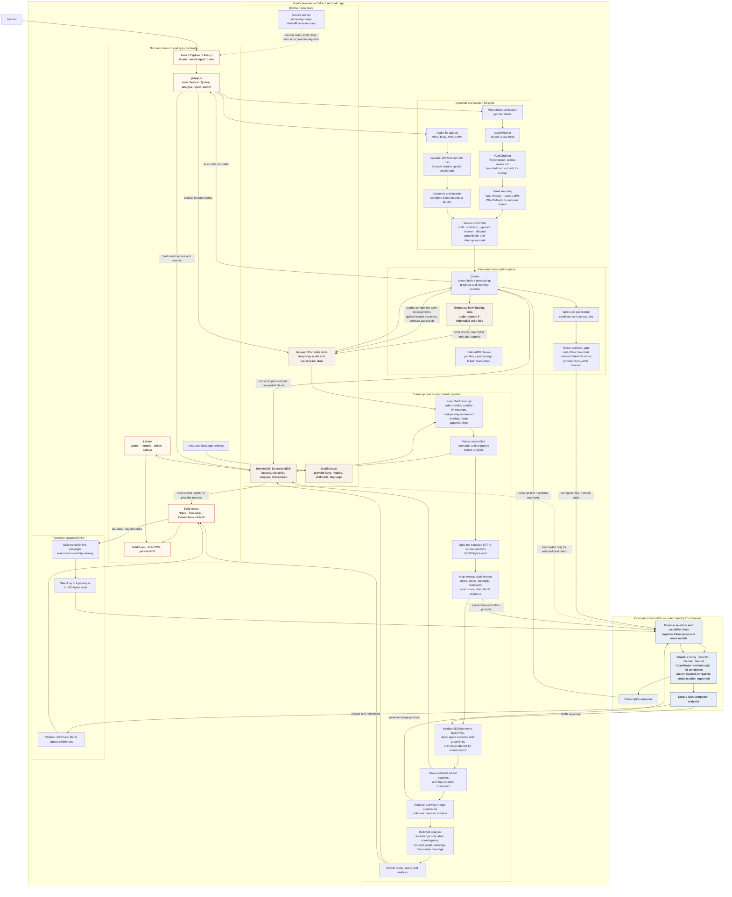
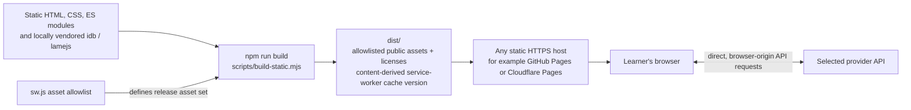

# DeLectured application architecture

DeLectured is a static, browser-only lecture capture and study application. The
browser coordinates capture, local persistence, provider requests, analysis, and
rendering. There is no DeLectured application server or hosted database.

## Runtime architecture and data flow

## Static build and release

The release build copies only the public asset allowlist into `dist`; it does
not include source-only v2 references, tests, documentation, or local
configuration. Deployment is static hosting only. Provider inference remains a
separate external service and may incur provider usage charges.

## Important data and failure boundaries

| Data or operation | Location / destination | Behavior |
| --- | --- | --- |
| Provider keys and model preferences | Browser `localStorage` | Sent only to the selected provider endpoint; not included in lecture records or JSON backups. This is browser storage, not a secret vault. |
| Pending or failed audio | IndexedDB chunk records; RAM while a write is failing | Successful transcription atomically saves text and removes the audio blob. RAM-only audio does not survive reload or tab closure. |
| Lectures and study materials | IndexedDB `DeLecturedDB` | Local-first storage; the service worker does not sync it to a server. Browser clearing/eviction or changing origin can lose access; export backups regularly. |
| Transcription | Selected transcription provider | Audio chunks are sent directly from the browser. Offline chunks wait locally and resume while the app is open after reconnection. |
| Notes and Q&A | Selected completion provider | Transcript windows or retrieved Q&A passages are sent directly from the browser. Analysis checkpoints allow validated work to resume without retranscription. |
| Static application shell | Service-worker Cache Storage | Same-origin public shell assets only; provider requests and lecture data are not cached there. First-ever offline launch is not supported. |
| Import/export | Local file downloads and browser-selected files | JSON backups contain lecture records, not pending audio or credentials. Markdown/CSV exports and PDF printing are generated in the browser. |

Transcription and notes provider selections are saved per lecture. Network and
rate-limit retries are bounded; authentication, quota, unsupported requests,
and invalid responses require explicit user action. Capture gaps and uncertain
overlap are surfaced instead of fabricating transcript continuity. Evidence
quotes are checked for literal presence, but that does not establish that an
AI-generated interpretation is correct.
