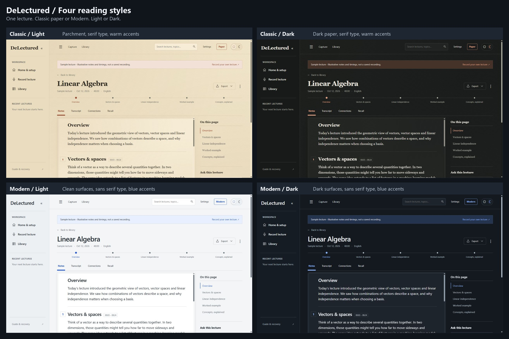
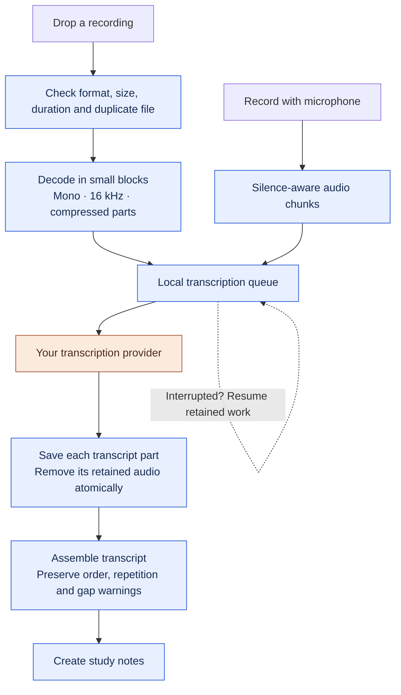
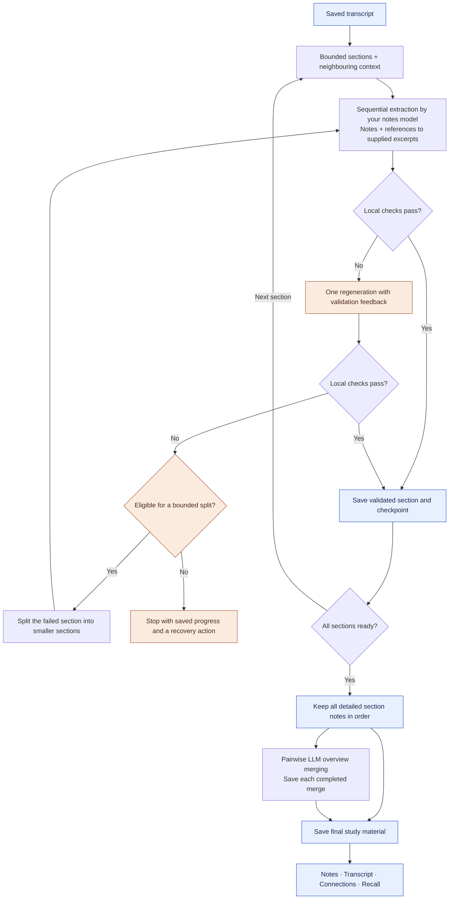
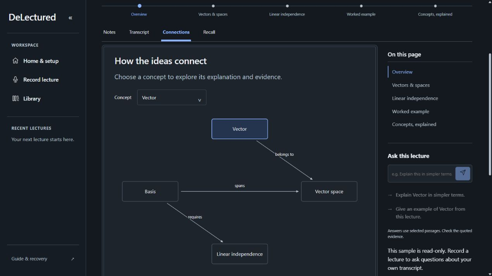
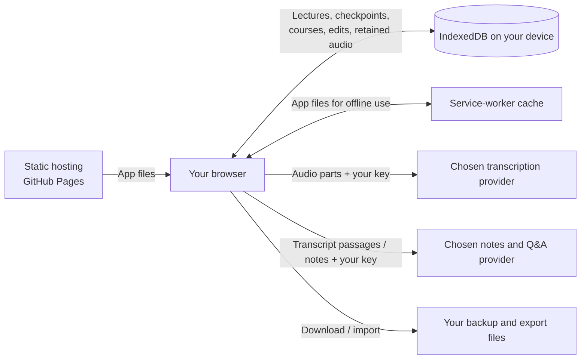

# DeLectured

**Every lecture, every word, structured.**

Turn lecture recordings into a study workspace: transcripts, structured notes, concept connections, recall cards and questions grounded in your lectures. DeLectured runs in your browser, uses the AI providers you choose, and keeps your library on your device. There is no DeLectured backend or application subscription; your providers' usage limits and charges still apply.

**[Open DeLectured](https://mauryapranav.github.io/Delectured/)** · **[Explore the sample lecture](https://mauryapranav.github.io/Delectured/index.html?demo=folio)** · [How it works](#how-it-works) · [Run locally](#run-locally)

## A workspace for the whole lecture

| From recording to revision | What you can do |
| --- | --- |
| Capture | Drop an MP3, M4A, WAV or MP4 file, or record through your microphone. Uploaded files can be up to **500 MiB and two hours**, subject to browser decoding support. |
| Choose providers | Use different providers for transcription and notes. Settings shows fields for your selected providers and can discover available models. |
| Follow progress | See audio preparation, transcription, notes generation and saving as separate steps, with recovery actions when something fails. |
| Study | Read the overview and detailed sections, inspect the transcript and supporting quotes, explore concept connections, and practise with recall cards. |
| Organise | Search and rename lectures, create courses, review suggested groups, and select which lectures belong together. |
| Make it yours | Edit a section's displayed notes and attach typed arrow annotations to passages. Personal edits stay separate from the generated analysis. |
| Ask and revise | Ask about one lecture or selected course lectures, follow references back to their source, and revisit cards marked for more practice. |
| Keep your work | Export Markdown, Anki CSV or a print-ready PDF. Use JSON backups to move your saved library between browsers or devices. |

This README describes the current repository. The public site reflects the latest deployed commit, so local changes appear there only after deployment.

## Four reading styles

Choose **Paper** for a textured, serif reading surface or **Modern** for clean surfaces and blue accents. Light and dark modes work independently of that choice. Appearance preferences are saved locally, and reduced-motion preferences are respected.

[](assets/readme/design-modes.jpg)

*Actual screenshots of the public sample lecture, captured on 26 October 2026. Click the image to enlarge it. No personal recordings or API keys are shown.*

Full-size views: [Classic Light](assets/readme/classic-light.jpg) · [Classic Dark](assets/readme/classic-dark.jpg) · [Modern Light](assets/readme/modern-light.jpg) · [Modern Dark](assets/readme/modern-dark.jpg)

## Start with your own lecture

1. Open [DeLectured](https://mauryapranav.github.io/Delectured/) and go to **Settings**.
2. Choose a **transcription provider** and a **notes provider**. They can be the same or different.
3. Enter your keys and exact model IDs. **Find models & suggest** can help find models exposed by your account; it does not guarantee available quota or successful inference. A model's display name is not always its API ID.
4. Open Capture and drop your recording. Review the processing plan and request allowance before starting. Keep the tab open while work is running.
5. Open the finished lecture in Library. If notes stop, use **Retry notes** to resume from saved progress rather than uploading and transcribing again.

Adapters exist for Groq, OpenAI, Google Gemini, Mistral, OpenRouter, Anthropic and custom OpenAI-compatible endpoints. OpenRouter and Anthropic are notes/Q&A options in this app. Supported operations depend on the selected model, account and browser access; the adapter list is not a claim that every model has been tested.

## How it works

### 1. Audio becomes a saved transcript

Uploaded audio is decoded incrementally, downmixed to mono, resampled to 16 kHz and encoded into approximately five-minute MP3 parts, with WAV as an encoder fallback. The app sends these parts to the transcription provider instead of sending the entire original file in one request.

The microphone path uses silence-aware cuts near five minutes, with bounded overlap at hard cuts. Uploaded parts do not add audio overlap. When assembling a transcript, the app removes repetition only where matching text and timestamps establish duplication inside a recorded overlap; intentional lecturer repetition remains.



### 2. Notes are extracted with context, checked and combined

**Audio parts and notes sections are different.** Notes generation splits the completed transcript into smaller sections bounded by UTF-8 bytes, preferring sentence and whitespace boundaries. Each request also receives a short tail of the previous section and the start of the next section for context. Those neighbouring passages help interpretation; they are not treated as new material to duplicate or cite for the current section.



- **Extraction:** the model writes a compact study packet and references numbered excerpts from the current source. Prompts treat lecture content as data, preserve terminology, and prohibit invented quotes and exam predictions.
- **Validation:** local code checks JSON structure, content bounds, references and concept links. Excerpt references are resolved to actual source text. These checks establish that quoted evidence exists; they do not prove every explanation is correct.
- **Repair:** a failed output gets one regeneration with specific feedback. Certain persistent format or size failures can trigger a bounded split into smaller sections. Authentication or rejected HTTP requests are not treated as invalid notes to regenerate blindly.
- **Checkpointing:** completed sections and overview merges are saved. Compatible retries reuse validated work; changing the model or other pipeline inputs can require notes to restart, while retaining the transcript.
- **Combining:** the LLM merges pairs of section notes into increasingly broad overviews. The final overview sits above the original detailed sections; it does not replace them. Concepts, recall cards and connections are assembled from the validated section output.

Implementation: [audio preparation](js/upload.js), [transcription queue](js/queue.js), [transcript assembly](js/transcript.js), [notes pipeline](js/pipeline.js), [evidence resolution](js/evidence-repair.js) and [study validation](js/study-validation.js).

### 3. Study and ask questions

[](assets/readme/connections.jpg)

**Lecture Q&A** selects a small set of relevant transcript passages locally before sending them to the notes provider. Answers must cite supplied passages. The model is instructed to decline unsupported questions; it is not a general web-search or outside-knowledge tutor. Word-based retrieval can miss relevant material, and valid quotations do not guarantee a sound interpretation.

**Courses** group saved lectures. Once at least three completed lectures are available, the app can suggest related groups using local title, topic and concept overlap. You review the name and membership before saving. Course Q&A lets you select up to 20 lectures and sends only a bounded set of matching passages. Course revision reuses existing recall cards and saves your practice ratings locally. Group suggestions and revision do not call an AI provider.

## Recovery and responsible API use

Requests are bounded, but generation is not guaranteed to finish on a provider's free quota. The app applies these controls:

| Situation | Behaviour |
| --- | --- |
| Starting notes | Estimates a request allowance and records attempts before sending them. Normal processing uses one extraction per section plus pairwise overview merges. Repairs and retries consume extra requests. |
| Multiple tabs | Browser locks coordinate notes jobs and per-lecture transcription queues to reduce duplicate work. Unsupported coordination blocks processing rather than risking duplicate requests. |
| Temporary network/provider failure or rate limit | Uses bounded retries and backoff, honours supplied retry delays, and pauses offline. A long cooldown or exhausted allowance requires user action. |
| Bad key, unavailable model or rejected request | Stops with stage and provider diagnostics so the setting can be fixed. Repeated retries do not fix these errors. |
| Invalid AI output | Applies local validation, one repair attempt and eligible bounded splitting; completed sections remain checkpointed. |
| Allowance exhausted | Stops and asks the user to review usage before explicitly allowing more requests. |
| Repeated course question | Reuses an in-page cached answer when the selected sources and request match. |
| Reading, searching, grouping or revising saved work | Works locally without new provider generation requests. |

Request allowances are local safeguards, **not account-wide billing caps**. Other tabs, devices or applications using the same key can still consume your provider quota. See [request accounting and backoff](js/request-budget.js).

When reporting a failure, copy **Problem details** from the app: the stage, provider, HTTP status when available, operation and request format help distinguish rejected requests from network failures. Do not include API keys or private lecture text.

## Storage, privacy and offline use



- **No application backend:** provider requests go directly from the browser to the configured provider. DeLectured does not host a central lecture database or sync your library between devices.
- **Keys:** new configurations use session-only key storage by default. Choosing to remember keys stores them in this browser; earlier remembered settings remain supported. Keys are sent to the selected providers and are not part of lecture JSON backups. Browser storage is not a secret vault: avoid shared profiles and untrusted custom endpoints.
- **Saved work:** IndexedDB stores transcripts, notes, checkpoints and retained audio. Saving a successful transcription and removing that part's retained audio happen in one transaction.
- **Unsaved audio:** RAM-only audio and unfinished microphone buffers cannot survive closing or reloading the tab. If storage fails, export retained audio before leaving. A paused upload may need the original file selected again for portions not yet prepared.
- **Backups:** browser data can be cleared or evicted. Export JSON backups regularly; they include saved lecture/course/personal-note data, but **not pending audio or API keys**. Export retained audio separately.
- **Origins matter:** localhost, different ports, the public site and different browser profiles have separate libraries. Use backup/export and import when moving between them.
- **Offline:** after the app has been cached, saved lectures can be read offline. New transcription, notes and answers still require provider connectivity. When an update is ready, finish work and export RAM-only audio before closing all app tabs and reopening. Do not clear site data to apply an update.

## Run locally

Use **Node.js 24.13.0**, matching the deployment workflow. Runtime dependencies are pinned to **idb 8.0.4**, **lamejs 1.2.1** and **mediabunny 1.61.6**. Storage tests use **fake-indexeddb 6.2.5**.

```sh
npm ci
npm test
npm run build
python -m http.server 8000 --directory dist
```

The last command requires Python 3; another static server can also serve `dist`. Open [localhost:8000](http://localhost:8000/) or the [local sample lecture](http://localhost:8000/index.html?demo=folio). Microphone access requires HTTPS or localhost. The sample is read-only and requires no provider key.

**Serve `dist`, not repository-root HTML.** The build combines page content into the shared navigation shell, includes local runtime dependencies and licences, and versions the offline cache. Rebuild after source changes.

| Code | Responsibility |
| --- | --- |
| `js/app.js`, `js/session.js`, `js/router.js` | App lifecycle, capture sessions and navigation |
| `js/upload*.js`, `js/recorder.js`, `js/queue.js` | File preparation, recording and transcription |
| `js/providers/`, `js/provider-settings.js` | Provider adapters, model discovery and settings |
| `js/pipeline.js`, `js/study-*.js`, `js/request-budget.js` | Notes, validation, checkpoints and request controls |
| `js/report.js`, `js/chat.js`, `js/courses.js`, `js/personal-notes.js` | Reading, questions, courses and personal edits |
| `js/store.js`, `js/schema.js`, `js/exports.js` | Persistence, data validation and exports |
| `scripts/build-static.mjs`, `sw.js` | Public build allowlist and offline app updates |

## Testing and deployment

`npm test` runs the Node test suite, including upload preparation, provider contracts, recovery, schema/evidence validation, storage, courses and personal notes. Browser harnesses in [tests/browser](tests/browser) exercise rendering, navigation, appearance, long uploads and the study workspace; they are separate from `npm test` and require Playwright and a Chromium-family browser.

Automated fixtures and the sample lecture do not establish successful authenticated inference for every provider/model. Physical microphones, actual mobile devices, decoding support and provider quotas need testing in the target environment.

The [GitHub Pages workflow](.github/workflows/deploy-pages.yml) runs `npm ci`, `npm test` and `npm run build`, then publishes **only `dist`** on pushes to `main` or a manual run. No provider API keys belong in GitHub Actions or repository files. Tests, documentation screenshots, local plans and old v2 files are not included in the public app build.

Live URL: **[https://mauryapranav.github.io/Delectured/](https://mauryapranav.github.io/Delectured/)**. The suggested GitHub About description and website field are in [.github/ABOUT.md](.github/ABOUT.md); pushing that file alone does not update repository settings.
